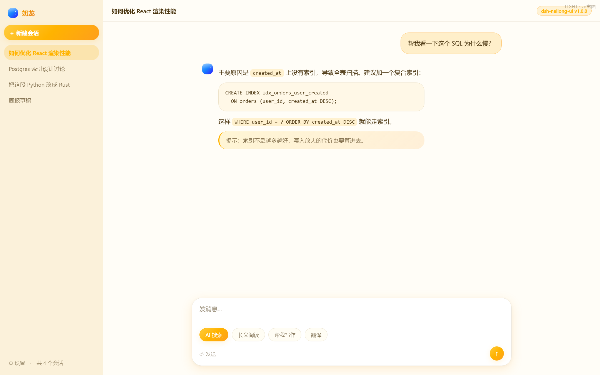
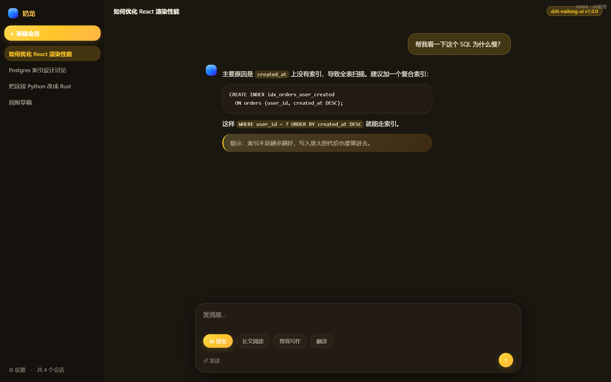

# dsh-nailong-ui

**An egg-yolk yellow theme for the [DeepSeek Harness](https://www.deepseek.com/harness/) Web client.**




> These are **mockups** rendered by `node scripts/preview.mjs`, not screenshots of
> DSH. The layout is hand-written and does not reflect the host's real DOM density
> or spacing; check the live app for the true result.

> [!IMPORTANT]
> **This plugin contains no Nailong artwork.**
>
> Nailong is a copyrighted cartoon character. This plugin includes **no**
> character art, emoji, official palette file or any official asset. It borrows
> only the abstract "bright yellow + rounded geometry" visual language — colours
> and corner radii are not copyrightable. The brand mark is a self-drawn
> *generic* rounded-dinosaur silhouette (circle head, two back spikes, two eyes),
> not a tracing of any specific character.
>
> Unofficial, community-maintained. Not affiliated with, authorised by, or
> endorsed by the character's rights holders.

## ⚠️ Colours are derived, not measured

Nailong is a film / short-video IP with **no published CSS design tokens** — it
is not a software product. Web research found no authoritative colour
specification.

Every colour here is induced from the character's public appearance:

| Element | Value | Basis |
| --- | --- | --- |
| Egg-yolk body | `#FFC629` / `#FFB300` | visual induction |
| Warm orange accents | `#FF9F1C` / `#F08000` | gradients and emphasis |
| Cream | `#FFF8E7` | cream base |
| Deep brown text | `#4A3510` | **not pure black** — black on warm yellow reads harsh and dirty |

Do **not** cite these as official Nailong colour values. The sibling
[`dsh-doubao-ui`](https://github.com/JAKE1266/dsh-doubao-ui) does use measured
tokens from Doubao's shipped CSS; this one does not.

## What it does

### Layer 1 — skin (pure CSS token overrides)

- Egg-yolk yellow brand with warm-orange accents on cream surfaces; replaces
  DSH's full `--dsw-alias-*` / `--dsw-static-*` / `--dsw-specific-*` set.
- **Dark theme uses deep warm brown** `#1A1610`, not cold black: bright yellow is
  glaring on pure black but reads like a night light on warm brown.
- **Rounded geometry throughout**: radii 8/12/16/20/24/26/28px with no 4px sharp
  corners. The cartoon feel comes from the absence of sharp angles.
- **Springy motion**: `cubic-bezier(.34, 1.4, .64, 1)` overshoots, so pills and
  the send button lift-and-scale on hover and squash on press.
- Warm-tinted shadows `rgba(120, 82, 10, …)` instead of neutral black.
- Scrollbars, brand-tinted `::selection`, brand-accented blockquotes, brand focus
  ring.
- Every blue token (`--dsw-static-deepseek-*`, `--dsw-static-blue-*`) is
  remapped to warm orange — the character's palette has no blue, and leaving it
  would leak blue into links and icons.

### Layer 2 — components (declarative React slots)

| Slot | Contribution |
| --- | --- |
| `sidebar.brand.mark` / `sidebar.brand.name` | Abstract dinosaur mark + the "奶龙" name (`priority:-1` shadows the official occupant) |
| `conversation.hero.brand.mark` | Large mark on the new-conversation page |
| `conversation.hero.options` | Four quick-action pills: `AI 搜索 / 讲个故事 / 帮我写作 / 翻译` |
| `settings.section` | About page: capabilities, provenance, rollback |

## Install

```bash
# from GitHub (client/client.js is committed; no prepare script)
dsh plugin --profile desktop add github:JAKE1266/dsh-nailong-ui

# from a local clone
git clone https://github.com/JAKE1266/dsh-nailong-ui.git
cd dsh-nailong-ui
node scripts/build.mjs && node test/run-all.mjs
dsh plugin --profile desktop add link:$(pwd)
```

**Activate:** restart DSH Web, then hard-refresh (`Ctrl+Shift+R`). `<html>`
should carry `data-dsh-nailong-skin="1.0.0"`.

**Disable / remove:**

```bash
dsh plugin --profile desktop disable dsh-nailong-ui
dsh plugin --profile desktop remove dsh-nailong-ui
```

## ⚠️ Only one full-site skin at a time

Conflicts with `dsh-doubao-ui`, `dsh-kimi-ui`, `dsh-wechat-ui` and
`dsh-zcode-ui` — all override the same `--dsw-*` tokens.

## Preview

```bash
node scripts/preview.mjs          # light -> assets/preview-light.png
node scripts/preview.mjs --dark   # dark  -> assets/preview-dark.png
```

Renders the real skin CSS against a simulated layout via headless Edge. **It is a
mockup, not a screenshot.**

## Customizing

| Want to change | Edit |
| --- | --- |
| Brand colour and gradients | `LIGHT/DARK['--dsw-alias-brand-primary']` and the `--nl-*` vars |
| Page / sidebar / card backgrounds | `--dsw-alias-bg-*` |
| Radii, shadows, font sizes | `STRUCTURAL` |
| Composer, pills | `STRUCTURE_CSS` |
| Bounce strength | the second parameter of `--nl-ease` (higher = springier) |
| Quick-action copy | `QUICK_ACTIONS` |
| Brand mark | `MARK_SVG` in `src/artwork.mjs` |

Rebuild after editing: `node scripts/build.mjs && node test/run-all.mjs`.

## Verification

```bash
node test/run-all.mjs
```

Zero-dependency suite, **19 checks**: factory contract, four inlined modules,
dual-theme CSS, light/dark key-set parity (208 tokens), idempotent injection and
teardown, `apply` fault tolerance, slot declarations, `priority:-1`,
`insertDraft`, React-missing degradation, three-place version consistency,
manifest consistency.

## License

[MIT](LICENSE) for the code. The "Nailong" name and character are the property of
their rights holders; this plugin includes none of that material.
