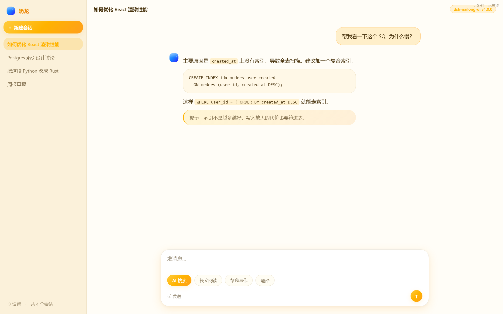
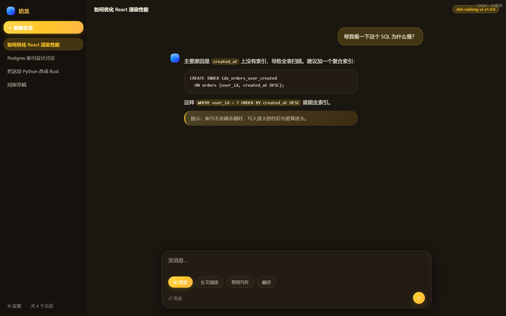

# dsh-nailong-ui

**给 [DeepSeek Harness](https://www.deepseek.com/harness/) Web 换一套明黄主题。**




> 上图为 **示意图**（由 `node scripts/preview.mjs` 渲染），用于展示配色、圆角与层次，
> **不是 DSH 真实截图** —— 布局是手写的近似，真实效果请启用插件后查看。

> [!IMPORTANT]
> **本插件不含任何奶龙形象素材。**
>
> 奶龙是有版权的卡通形象。本插件**不包含**角色立绘、表情包、官方配色文件或任何官方素材。
> 它只借用「明黄色系 + 圆润几何」这一层**抽象的视觉语言** —— 色彩与圆角本身不受版权保护。
> 品牌标记是自创的「圆润小恐龙轮廓」抽象图形（圆形头 + 两枚背刺 + 两点眼），
> 属于通用恐龙剪影语法，**不是任何具体角色的临摹**。
>
> 本插件是个人维护的非官方项目，与奶龙形象的权利人无任何隶属、授权或背书关系。
> 「奶龙」名称归其权利人所有，此处仅用于说明配色灵感来源。

---

## ⚠️ 色值是推导，不是实测

奶龙是影视 / 短视频 IP，**没有公开的 CSS 设计令牌表**（它不是软件产品）。网络检索也未找到可靠的官方色值规范。

因此本皮肤的全部色值都是**基于对该形象公开观感的归纳**：

| 设计元素 | 取值 | 依据 |
| --- | --- | --- |
| 明黄身体 | `#FFC629` / `#FFB300` | 蛋黄黄的观感归纳 |
| 暖橙细节 | `#FF9F1C` / `#F08000` | 渐变与强调色 |
| 奶白肚皮 | `#FFF8E7` | 奶白基调 |
| 深棕文字 | `#4A3510` | **不用纯黑** —— 纯黑在暖黄底上对比过硬、显脏 |

**请不要把本文件当作奶龙官方色值引用。** 同系列的 [`dsh-doubao-ui`](https://github.com/JAKE1266/dsh-doubao-ui) 用的是从豆包官方 CSS 读到的**实测**令牌；本插件不是。

---

## 它做什么

### 第一层 · 皮肤（纯 CSS 令牌覆盖）

| 方面 | 皮肤做了什么 |
| --- | --- |
| **配色** | 明黄主色 + 奶白暖调表面 + 深棕文字，覆盖 DSH 全部 `--dsw-alias-*` / `--dsw-static-*` / `--dsw-specific-*` 语义令牌 |
| **明暗主题** | 亮色奶白底；暗色用**深暖棕** `#1A1610` 而不是冷黑 —— 明黄在纯黑上刺眼，在暖棕上像小夜灯 |
| **圆润几何** | 圆角全部偏大且彼此接近（8/12/16/20/24/26/28px），**没有 4px 这种锐角** |
| **回弹动效** | `cubic-bezier(.34, 1.4, .64, 1)` —— 带过冲的弹性缓动，胶囊与按钮 hover 时会「弹一下」 |
| **侧栏分色** | 亮色奶黄 `#FBF1DA` vs 主区奶白 `#FFFDF7`；暗色 `#15110C` vs `#1A1610` |
| **暖色阴影** | 阴影用 `rgba(120, 82, 10, …)` 暖棕调，不是中性黑 |
| **细节** | 细圆滚动条、明黄选中文本、明黄引用左边框、明黄焦点环 |
| **可访问性** | 尊重 `prefers-reduced-motion`；不破坏 DSH 的「仅键盘显示焦点环」逻辑 |

### 第二层 · 组件（声明式 React 插槽）

| 插槽 | 贡献 |
| --- | --- |
| `sidebar.brand.mark` / `sidebar.brand.name` | 抽象小恐龙标记 + 「奶龙」名称（`priority:-1` 盖掉官方品牌占位） |
| `conversation.hero.brand.mark` | 新会话首页大号标记 |
| `conversation.hero.options` | 4 个快捷胶囊：`AI 搜索 / 讲个故事 / 帮我写作 / 翻译` |
| `settings.section` | 「关于」页：能力边界、来源声明、回滚方式 |

---

## 为什么主体是「CSS 变量覆盖」

DSH Web 的整站视觉由 `--dsw-alias-*` 变量在 `body` 上驱动。在变量层替换，就能在不触碰任何业务组件的前提下换掉全站外观：

- **零依赖**：没有构建框架、没有运行时依赖，`npm install` 都不需要。
- **升级友好**：不依赖宿主的 CSS Module 哈希类名，所有选择器走 `:root` / `body` / 实测 `data-*` 锚点。
- **停用即恢复**：样式与组件注册都由 `ctx.effect` 管理生命周期。
- **不会白屏**：加载器不隔离 entry 工厂。本插件所有初始化都包在 try 里；组件层连模块顶层都不 `require('react')`（惰性绑定），React 缺失时整体降级为纯 CSS 皮肤。

---

## 安装

```bash
# 从 GitHub（client/client.js 已提交，无 prepare 脚本，安装不编译）
dsh plugin --profile desktop add github:JAKE1266/dsh-nailong-ui

# 从本地源码
git clone https://github.com/JAKE1266/dsh-nailong-ui.git
cd dsh-nailong-ui
node scripts/build.mjs && node test/run-all.mjs
dsh plugin --profile desktop add link:<本目录绝对路径>
```

把 `desktop` 换成实际运行 DSH Web 的 profile 名。

### 生效

1. **重启 DSH Web**。
2. 硬刷新浏览器（`Ctrl+Shift+R`）。
3. DevTools 里 `<html>` 应出现 `data-dsh-nailong-skin="1.0.0"`，`<head>` 里有两张样式表。

### 停用 / 卸载

```bash
dsh plugin --profile desktop disable dsh-nailong-ui
dsh plugin --profile desktop remove dsh-nailong-ui
```

---

## ⚠️ 与其他皮肤互斥

**同时只能启用一个全站换肤插件。** 本插件与 `dsh-doubao-ui`、`dsh-kimi-ui`、`dsh-wechat-ui`、`dsh-zcode-ui` 都覆盖同一批 `--dsw-*` 令牌，同时启用会混色。

---

## 预览

```bash
node scripts/preview.mjs          # 亮色 -> assets/preview-light.png
node scripts/preview.mjs --dark   # 暗色 -> assets/preview-dark.png
```

用本机 Edge headless 把真实皮肤 CSS 渲染到模拟布局上。**是示意图，不是真实截图。**

---

## 改颜色 / 改组件

| 想改什么 | 改哪里 |
| --- | --- |
| 主色与渐变 | `LIGHT/DARK['--dsw-alias-brand-primary']` 及 `--nl-*` 私有变量 |
| 页面/侧栏/卡片底色 | `--dsw-alias-bg-*` |
| 圆角 / 阴影 / 字号 | `STRUCTURAL` |
| 输入框与胶囊形态 | `STRUCTURE_CSS` |
| 回弹强度 | `--nl-ease` 的 `cubic-bezier` 第二个参数（越大越弹） |
| 快捷入口文案 | `QUICK_ACTIONS` |
| 品牌图标 | `src/artwork.mjs` 的 `MARK_SVG` |

改完必须重建（产物随仓库提交）：

```bash
node scripts/build.mjs && node test/run-all.mjs
```

---

## 验证

```bash
node test/run-all.mjs
```

零依赖自包含套件，**19 项检查**：产物语法与工厂契约、4 模块内联、双主题 CSS、亮/暗键集合一致性、样式幂等与回收、`apply` 容错、组件层插槽声明、`priority:-1`、`insertDraft` 写入与派发、React 缺失降级、版本三处一致、manifest 自洽。

---

## License

[MIT](LICENSE) — 代码部分。「奶龙」名称及相关形象版权归其权利人所有；本插件不包含任何该等素材。
